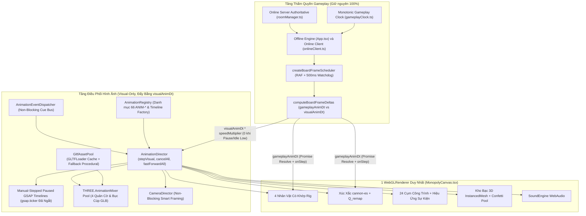
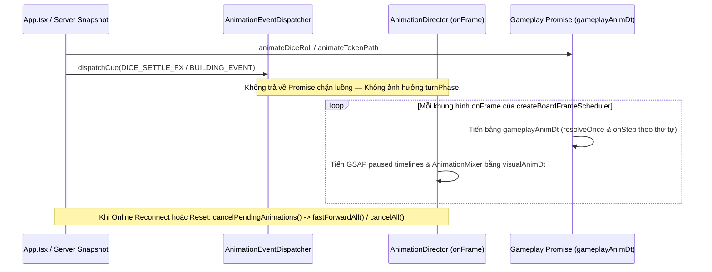

# ANIMATION SYSTEM ARCHITECTURE — Kiến Trúc Manual-Stepped GSAP + Three.js AnimationMixer

- **Ngày lập:** 2026-11-24 · **Nhánh:** `feature/3d-animation-overhaul` (Baseline `68c8d50`)
- **Mục tiêu cốt lõi:** Mở rộng trải nghiệm hình ảnh 3D đạt chuẩn thương mại mà **bảo toàn tuyệt đối 12 chốt chặn kiến trúc gameplay & iGPU từ Phase 1**, không viết lại `App.tsx` hay `roomManager.ts`, và không bao giờ tạo vòng lặp render thứ hai.

---

## 1. Sơ Đồ Kiến Trúc Tổng Thể



---

## 2. Cơ Chế Tích Hợp GSAP Thủ Công (Manual-Stepped Paused Timelines)

### 2.1 Vì sao **KHÔNG** dùng GSAP Global Ticker mặc định?
Nếu giữ vòng ticker mặc định của GSAP (`requestAnimationFrame` tự chạy toàn cục):
1. GSAP chạy một vòng lặp RAF độc lập ở `60 Hz` ngay cả khi bàn cờ đang ngủ `0 FPS` ở mức `Low` hoặc bị che bởi `StartModal` → **phá vỡ tối ưu iGPU**.
2. Khi người chơi mở `PauseModal`, mở `RulebookModal`, hoặc tab nền đang bị throttle, đồng hồ nội bộ của GSAP vẫn trôi lệch pha với `isPausedRef` và `visualAnimDt` của `MonopolyCanvas.tsx`.
3. Không đồng bộ chính xác với `justResumedFromPauseRef` (frame đầu tiên sau Resume phải kẹp `<= 0.05s`) và khó thực thi fast-forward tức thì khi nhận `ROOM_SNAPSHOT` mới lúc Reconnect.

### 2.2 Giải Pháp Kỹ Thuật Chuẩn Xác (Xác minh theo tài liệu GSAP v3)
Ngay khi khởi tạo `src/three/animationDirector.ts`:
```ts
import gsap from 'gsap';

let gsapDetached = false;
export function detachGsapFromGlobalTicker(): void {
  if (gsapDetached) return;
  gsapDetached = true;
  gsap.ticker.remove(gsap.updateRoot);
  gsap.ticker.lagSmoothing(0);
  gsap.ticker.sleep();
}
```
- Mỗi animation trong `AnimationDirector` tạo một `gsap.timeline({ paused: true })` (tách biệt theo `id` và `category`).
- Trong vòng `onFrame` duy nhất của [MonopolyCanvas.tsx](file:///d:/Code/Project/cờ-tỷ-phú-3d-việt-nam/src/components/MonopolyCanvas.tsx#L2487-L2563), `AnimationDirector.step(visualAnimDt, speedMultiplier)` cộng dồn thời gian cục bộ cho từng timeline đang hoạt động (`tl.totalTime(nextTime, false)` hoặc `mixer.update(scaledVisualDt)`).
- **Lợi ích tuyệt đối:**
  - `0` vòng RAF phụ, `0` timer thừa khi nghỉ (`Low` giữ nguyên `0 FPS` idle).
  - Đóng băng 100% khi `isPaused === true` (`visualAnimDt === 0`).
  - Hỗ trợ `fastForwardToEnd()` (đưa thẳng `tl.progress(1, false)`) và `cancel()` tức thì khi đổi ván / Reconnect / Unmount mà không sợ callback ẩn bắn trễ.

---

## 3. Giao Diện `AnimationDirector`, `AnimationRegistry` & `AnimationEventDispatcher`

```ts
export type AnimationCategory =
  | 'character'
  | 'dice'
  | 'building'
  | 'economy'
  | 'camera'
  | 'event'
  | 'endgame';

export interface ManagedVisualTimeline {
  readonly id: string;
  readonly category: AnimationCategory;
  /** True for short event/action animations that keep board rendering until finished, even on Low tier. */
  readonly blocksIdleSleep: boolean;
  /** Advance visual state by `scaledVisualDtSec`. Returns false once completed. */
  advance(scaledVisualDtSec: number): boolean;
  /** Jump cleanly to final visual pose on Reset / Online snapshot resync. */
  fastForwardToEnd(): void;
  /** Abort immediately and release temporary visual nodes back to pools. */
  cancel(): void;
}

export type AnimationCuePayload =
  | { kind: 'DICE_ANTICIPATION'; die1: number; die2: number; choice: TacticalDiceChoice }
  | { kind: 'DICE_SETTLE_FX'; isDoubles: boolean; choice: TacticalDiceChoice }
  | { kind: 'TOKEN_REACTION'; playerId: number; reaction: 'cash_gain' | 'cash_pay' | 'buy_proud' | 'bankrupt' | 'jail' }
  | { kind: 'BUILDING_EVENT'; tileIndex: number; effect: 'buy' | 'upgrade' | 'landmark' | 'buyout' | 'sell' | 'quake' | 'outage' | 'shield_on' | 'shield_break' | 'championship' | 'monopoly_wave'; colorHex?: string }
  | { kind: 'CHANCE_CARD_3D_FLIP'; cardId: string }
  | { kind: 'WORLD_TOUR_FLIGHT'; playerId: number; fromTile: number; toTile: number }
  | { kind: 'ENDGAME_CEREMONY'; winnerIds: number[]; teamMode: boolean };
```

### Luồng Hoạt Động Non-Blocking (`sequenceDiagram`)



---

## 4. Vòng Đời An Toàn: Pause, Reset, Unmount, WebGL Context Loss & Online Resync

| Sự kiện vòng đời | Hành động của `AnimationDirector` & `CameraDirector` | Đảm bảo an toàn |
|---|---|---|
| **Pause (`isPaused = true`)** | `computeBoardFrameDeltas` trả `gameplayAnimDt = 0` và `visualAnimDt = 0`; mọi GSAP timeline, `AnimationMixer` và `CameraDirector` đứng yên hoàn toàn tại frame hiện tại. | Không mất tiến độ, không nhảy cóc khi Resume (`justResumedFromPauseRef` kẹp frame đầu `<= 0.05s`). |
| **Reset Game / Chuyển ván mới** | `App.tsx` tăng `sessionEpochRef` và gọi `canvasRef.current?.cancelPendingAnimations()`. `AnimationDirector` hủy sạch (`cancelCategory('all')`), thu hồi toàn bộ hạt về pool, đặt lại camera về `Overview` và trả `Mixer` về `idle_loop`. | 0 callback ván cũ lọt sang ván mới; 0 timer rò rỉ. |
| **Online Reconnect / F5 Resync (`prevOnlineSyncedRef`)** | Khi client chuyển `isSynced: false -> true` hoặc nhận `ROOM_SNAPSHOT` nhảy cóc `decisionRevision` lớn hơn hiện tại: gọi `director.fastForwardAll()` để chốt ngay trạng thái công trình/màu/cúp khớp 100% với snapshot thẩm quyền từ server. | Hình ảnh bàn cờ luôn phản ánh chính xác state từ server. |
| **Unmount `MonopolyCanvas`** | `director.dispose()` dừng toàn bộ timelines, gọi `mixer.stopAllAction()`, `mixer.uncacheRoot(root)`, giải phóng bản sao model (giữ lại asset cache dùng chung nếu cần hoặc dọn sạch toàn bộ tùy lifecycle), gỡ listeners. | Không rò rỉ bộ nhớ GPU/JS heap. |
| **WebGL Context Loss / Restore** | Khi `webglcontextlost`: tạm đóng băng `frameScheduler`; khi `webglcontextrestored`: `fastForwardAll()` và khôi phục tư thế nhân vật/công trình theo `playersRef` / `propertiesRef` hiện tại. | Tương thích 100% bài E2E `BUG-44`. |

---

## 5. Thiết Kế Cải Tiến `waitGameBeat` (Khắc Phục Throttling Tab Nền)

Trong [App.tsx](file:///d:/Code/Project/cờ-tỷ-phú-3d-việt-nam/src/App.tsx#L955-L975), `waitGameBeat` hiện trừ cứng `stepMs = 60` mỗi lần callback `setTimeout(..., 60)` chạy. Khi người chơi chuyển tab sang cửa sổ khác, Chrome giảm tần suất `setTimeout` xuống `1.000ms` (`1 Hz`), làm nhịp chờ `740ms` bị kéo giãn lên `~10.5s` (13 lần tick × ~800–1000ms).

**Phương án nâng cấp (triển khai ở Wave 1 — giữ nguyên 100% thời lượng khi hiển thị, 0 thay đổi luật chơi):**
- Tính tiến độ bằng **đồng hồ đơn điệu `performance.now()`** (`deltaMs = now - lastCheckedMs`), **chỉ cộng vào `elapsedActiveMs`** khi `screenStateRef.current === 'playing' && !onlinePauseOpenRef.current`.
- Khi `isPaused` thì giữ `lastCheckedMs = now` mà không cộng `elapsedActiveMs` (bảo toàn hành vi dừng khi mở `PauseModal`), còn khi tab bị che khuất (`screenState === 'playing'`) thì ngay lần `setTimeout` kế tiếp sau `~1.0s`, `deltaMs >= targetMs` sẽ resolve ngay thay vì mất 10 giây!

---

## 6. Bảng Cam Kết Bảo Toàn 12 Thành Quả Của Phase 1 (Mục 6)

| # | Thành quả Phase 1 bắt buộc giữ nguyên | Cách Architecture mới bảo vệ tuyệt đối |
|---|---|---|
| 1 | `gameplayAnimDt` | Chỉ dùng để tiến `activeDiceAnimRef` & `activeHopAnimRef` — không chia sẻ quyền quyết định với GSAP. |
| 2 | `visualAnimDt` | Là đầu vào duy nhất điều khiển mọi `gsap.timeline({ paused: true })`, `AnimationMixer` và `CameraDirector`. |
| 3 | `computeBoardFrameDeltas()` | Giữ nguyên hàm thuần & bộ test trong `src/game/graphicsQuality.ts:337-355`. |
| 4 | `createBoardFrameScheduler()` | Vẫn là bộ điều phối khung hình duy nhất; nhận thêm cờ `director.hasBlockingVisualAnimations()` cho `hasActiveMotion` (chỉ true khi có clip hành động, KHÔNG true cho `Idle` trên `Low`). |
| 5 | Single-flight RAF fallback `500ms` | Không chạm tới cơ chế watchdog `scheduleToken` và ngưỡng `500ms`; đảm bảo `5 / 2.5 FPS` chạy thuần RAF. |
| 6 | `resolveOnce()` | Tiếp tục bọc mọi Promise `animateDiceRoll` & `animateTokenPath`, không thay thế bằng GSAP `onComplete`. |
| 7 | Thứ tự `onStep` | Vẫn chạy trong vòng `while (remainingHopDt > 0)` theo `gameplayAnimDt`; khi nhân vật nhảy nhiều ô trên máy FPS thấp, `onStep(stepIdx, tileIdx)` vẫn bắn đủ từng bước qua Bắt Đầu (+300K) theo đúng thứ tự. |
| 8 | `cancelPendingAnimations()` | Mở rộng để hủy/tua nhanh thêm hàng đợi `AnimationDirector` mà vẫn giữ hành vi chốt xúc xắc/quân cờ tức thì. |
| 9 | `decisionRevision` | Không thay đổi hay phụ thuộc vào animation; Online state chỉ đổi khi server tăng `decisionRevision`. |
| 10 | `actionId` | Không thay đổi định danh chống duplicate trên `onlineClient.ts` & `roomManager.ts`. |
| 11 | `isSynced` | Mọi visual cue từ `ROOM_SNAPSHOT` trước khi `isSynced === true` đều fast-forward thay vì xếp hàng phát chậm. |
| 12 | `gameplayClock.ts` & Server Authority | Đồng hồ trận `20:00`, đồng hồ lượt `45s` và mọi kết quả kinh tế/xúc xắc server giữ nguyên 100%. |
