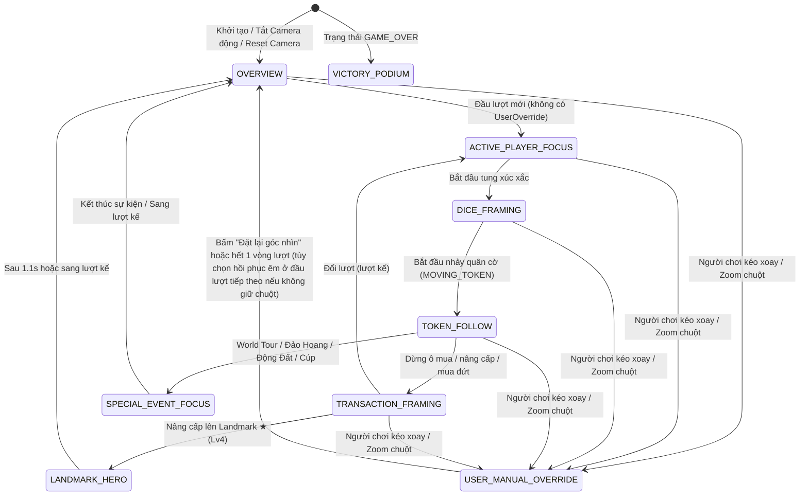

# CAMERA DIRECTOR SPECIFICATION — Non-Blocking Smart Framing

- **Ngày lập:** 2026-11-24 · **Nhánh:** `feature/3d-animation-overhaul` (Baseline `68c8d50`)
- **Nguyên tắc thiết kế (Chốt qua `/grill-me` D3):**
  1. **Bật mặc định (Non-Blocking Smart Framing):** Thay giá trị khởi tạo `cinematicCamera` từ `false` (`App.tsx:326`) sang `true`, giữ nguyên nút bật/tắt `Camera bám theo quân cờ` trên [ActionDock.tsx](file:///d:/Code/Project/cờ-tỷ-phú-3d-việt-nam/src/components/ActionDock.tsx#L386-L399) (lưu `localStorage` để tôn trọng sở thích người chơi).
  2. **Không bao giờ chặn thao tác hay làm lệch Online:** Mọi chuyển động camera chạy song song và thuần hiển thị. Nếu người chơi bấm nút Mua đất/Đổ xúc xắc ngay trong lúc camera đang trượt, giao dịch và UI thực thi tức thì ở `0ms` trễ.
  3. **Tôn trọng quyền điều khiển thủ công (`OrbitControls`):** Bất kỳ thao tác kéo xoay, thu phóng (`pointerdown` trên canvas hoặc `OrbitControls 'start'` kèm delta góc/khoảng cách) đều **ngắt `CameraDirector` ngay lập tức**, sửa lỗi cũ khi `animateDiceRoll`/`animateTokenPath` tự tiện xóa `manualOrbitOverrideRef.current = false` (`MonopolyCanvas.tsx:546, 582`).

---

## 1. Máy Trạng Thái `CameraDirector`

> **Quy tắc `USER_MANUAL_OVERRIDE` mới:** Khác với code cũ tự xóa cờ ngay khi người chơi bấm nút Đổ xúc xắc, `CameraDirector` mới sẽ giữ `USER_MANUAL_OVERRIDE` trong suốt phần còn lại của lượt hiện tại nếu người chơi đang chủ động chỉnh góc camera, và chỉ tự động hồi phục êm về `ACTIVE_PLAYER_FOCUS` khi chuyển sang `turnCount` mới (hoặc ngay lập tức khi người chơi bấm nút Reset Camera).

---

## 2. Bảng Thông Số Kỹ Thuật 9 Shot (`ANIM-CAM-01` .. `ANIM-CAM-09`)

Hệ quy chiếu gốc: `FOV = 26°`, hướng chuẩn đường chéo isometric `dir = normalize(24.4, 24.8, 24.4)` (`visualTheme.ts:130-133`), 4 khay tiền góc đặt tại `(±10.65, -0.22, ±2.15)` và `(±2.15, -0.22, ±10.65)`.

| Mã Shot | Trạng thái | Điểm nhìn Target `(tx, ty, tz)` | Vector Offset Camera `(dx, dy, dz)` | Hệ số giảm chấn `λ` | Vùng an toàn & Ghi chú Framing |
|---|---|---|---|---|---|
| `ANIM-CAM-01` | **Safe Overview** | `(0, -0.18, 0)` (Desktop) / `(0, -0.32, 0)` (Portrait) | Theo `computeSafeBoardCameraPose(W, H)` | `4.0` | Giữ trọn 32 ô + 4 khay tiền góc không bị che bởi `PlayerHUD` & `ActionDock`. |
| `ANIM-CAM-02` | **Active Player Focus** | `pos * 0.58`, `ty = -0.10` | `(+11.2, +12.4, +11.2)` × scale màn hình | `3.6` | Lệch nhẹ 58% về phía ô đang đứng của người tới lượt; vẫn nhìn rõ trung tâm bàn cờ. |
| `ANIM-CAM-03` | **Dice Courtyard Framing** | `(0, +0.18, 0)` | `(+9.8, +11.2, +9.8)` | `4.8` | Ôm trọn sân cỏ giữa nơi 2 viên xúc xắc `cannon-es` nảy và va chạm. |
| `ANIM-CAM-04` | **Token Lead-Follow** | `(pos + leadVec) * 0.78`, `ty = +0.12` | `(+9.2, +10.2, +9.2)` | `5.4` | `leadVec = normalize(nextTile - currTile) * 0.85` giúp nhìn trước 2–3 ô phía trước hướng đi. |
| `ANIM-CAM-05` | **Transaction Framing** | `tilePos * 0.74`, `ty = +0.20` | `(+9.6, +10.6, +9.6)` | `4.2` | Hơi chếch để hộp thoại Mua/Nâng cấp ở giữa màn hình vẫn để lộ mặt ô & công trình bên cạnh. |
| `ANIM-CAM-06` | **Landmark ★ Hero** | `tilePos * 0.84`, `ty = +0.42` | `(+7.8, +7.6, +7.8)` | `4.6` | Góc hạ thấp hơn (`~18°` so với phương ngang bàn cờ) tôn chiều cao tháp Landmark ★ mới mọc. |
| `ANIM-CAM-07` | **Special Event Focus** | Tâm ô sự kiện * 0.78 | `(+8.8, +9.6, +8.8)` | `5.2` | Riêng **Động Đất (`ch-13`)**: cộng micro-shake tắt dần biên độ tối đa **`0.065` đơn vị thế giới** trong **`320ms`** (tắt = `0` khi `Low` hoặc `reducedMotion`). |
| `ANIM-CAM-08` | **Victory Podium Orbit** | `(0, +0.55, 0)` | Quay chậm `±12°` ở khoảng cách `(+9.4, +8.2, +9.4)` | `2.8` | Hướng nhẹ về bục chiến thắng giữa sân; khi `VictoryModal` bật lên thì giữ khung nền cân đối không chóng mặt. |
| `ANIM-CAM-09` | **Manual Override / Reset** | Vị trí `controls.target` người dùng chọn | Giữ nguyên góc `OrbitControls` | N/A | Bất kỳ kéo chuột/chạm nào chuyển ngay sang `USER_MANUAL_OVERRIDE`. |

---

## 3. Toán Học Nội Suy & Đáp Ứng Theo Màn Hình / Tầng Đồ Họa

1. **Nội suy Critically-Damped Exponential (bất biến FPS):**
   Thay vì `lerp(a, b, 0.1)` phụ thuộc FPS, dùng:
   $$\alpha(\Delta t) = 1 - e^{-\lambda \cdot \Delta t_{\text{visual}}}$$
   Với $\Delta t_{\text{visual}}$ (`visualAnimDt`, kẹp an toàn `<= 0.06s` mỗi frame trên hardware để camera không bao giờ nhảy vọt khi tụt FPS xuống `2.5 FPS`, sau khi đã xong lượt thì hội tụ êm về đích).
2. **Hệ số tỷ lệ Responsive (`viewportScale`):**
   Với màn hình hẹp chiều ngang (`aspect < 0.85` như Mobile `390×844`), nhân thêm hệ số khoảng cách `max(1.0, 0.92 / aspect)` vào các vector offset `ANIM-CAM-02..07` để camera zoom vào vừa phải mà không cắt mất quân cờ ra khỏi hai mép trái/phải.
3. **Ứng xử theo Chất lượng Đồ họa & `Reduced Motion`:**
   - **`Low`:** `CameraDirector` khóa ở `ANIM-CAM-01` (Overview) trong suốt lượt thường (tránh vẽ liên tục toàn bộ khung hình khi camera trôi ở iGPU yếu) và chỉ thực hiện cú chuyển nhanh gọn khi bắt buộc (`Reset Camera`, `Victory Podium`).
   - **`Medium` / `High`:** Chạy đầy đủ cả 9 shot mượt mà.
   - **`prefers-reduced-motion: reduce`:** Khóa khoảng cách cố định ở `ANIM-CAM-01`, tắt toàn bộ hiệu ứng dolly zoom, lắc Động Đất (`0.0` shake) và quỹ đạo quay ở bục chiến thắng.
4. **Hợp đồng với `OrbitControls`:**
   - Khi `CameraDirector` đang chủ động di chuyển, tạm thời giữ `controls.enableDamping = true` và cập nhật cả `camera.position` + `controls.target` trước khi gọi `controls.update()` (giữ đúng thứ tự trong `MonopolyCanvas.tsx:2365-2377` để không làm lệch 1 frame cho Floating Speech Bubble projection!).
