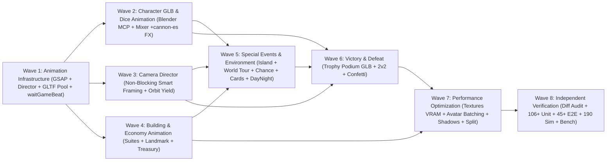

# IMPLEMENTATION PLAN — Lộ Trình 8 Wave Nâng Cấp Hệ Thống Animation 3D

- **Ngày lập:** 2026-11-24 · **Nhánh triển khai:** `feature/3d-animation-overhaul` (xuất phát từ Stable Gameplay Baseline `68c8d50`)
- **Trạng thái hiện tại:** **Chờ phê duyệt của chủ dự án trước khi bắt đầu Wave 1** (chưa sửa production code, chưa cài đặt `gsap`).
- **Quy tắc thực thi bắt buộc cho từng Wave:**
  1. Áp dụng TDD nghiêm ngặt cho mọi mô-đun hạ tầng/logic mới (`RED` → `GREEN`).
  2. Không cho 2 subagent cùng chỉnh sửa một file trong cùng một thời điểm.
  3. Kết thúc **mỗi Wave** phải chạy tối thiểu `npm run lint`, `npm test`, `npm run build` và bài E2E `--headed` liên quan; tuyệt đối giữ nguyên các chốt chặn Phase 1 và luật `CUSTOM`.

---

## Sơ Đồ Phụ Thuộc Giữa 8 Wave

> **Gợi ý chạy song song an toàn:** Sau khi hoàn tất **Wave 1**, hai nhánh **Wave 2** (Blender `.glb` + Nhân vật/Xúc xắc), **Wave 3** (`cameraDirector.ts` + hook `rules.ts`), và phần helper xây nhà của **Wave 4** có thể phân tách thành các file độc lập cho subagent thực hiện song song trước khi tích hợp nối dây vào `MonopolyCanvas.tsx`.

---

## Wave 1 — Animation Infrastructure (Nền Tảng Điều Phối & Vòng Đời)

1. **Phạm vi (Scope):**
   - Cài đặt `gsap` (`npm install gsap`), xây dựng lõi điều phối hình ảnh chạy bằng `visualAnimDt` với GSAP ngắt khỏi global ticker, bộ quản lý asset `.glb` kèm procedural fallback, sự kiện non-blocking `AnimationEventDispatcher` và nâng cấp `waitGameBeat` đơn điệu.
2. **Phụ thuộc (Dependencies):** Stable Gameplay Baseline `68c8d50`.
3. **File dự kiến tạo mới / chỉnh sửa:**
   - `package.json` & `package-lock.json` *(thêm duy nhất dependency `gsap`)*
   - `[NEW]` `src/three/animationDirector.ts` (GSAP manual-stepped `detachGsapFromGlobalTicker`, `AnimationDirector`, `AnimationRegistry`, lifecycle `step/fastForwardAll/cancelAll/dispose`)
   - `[NEW]` `src/three/animationEventBus.ts` (`AnimationEventDispatcher` & union `AnimationCuePayload`)
   - `[NEW]` `src/three/gltfAssetPool.ts` (`GLTFLoader` + `SkeletonUtils.clone` cache + graceful fallback)
   - `[NEW]` `src/three/animationDirector.test.ts` (`AT-UNIT-01`, `AT-UNIT-02`, `AT-UNIT-04`)
   - `[MODIFY]` `src/game/graphicsQuality.ts` & `src/components/MonopolyCanvas.tsx` (gắn `director.step(visualAnimDt, speedMultiplier)` vào `onFrame`, mở rộng `cancelPendingAnimations()`, dọn cleanup Pause/Reset/Unmount/Online `isSynced`)
   - `[MODIFY]` `src/App.tsx` (nâng cấp `waitGameBeat` dùng delta `performance.now()`, phát `AnimationCuePayload` không chặn luồng)
4. **Animation triển khai:** Hạ tầng dùng chung cho toàn bộ `ANIM-*` (chưa thay thế hiệu ứng gameplay cụ thể) + nền tảng `prefers-reduced-motion` (`matchMedia`).
5. **Rủi ro kỹ thuật & Giảm thiểu:**
   - *Rủi ro:* GSAP tự khởi chạy `gsap.ticker` do import side-effect phá vỡ `0 FPS` idle ở `Low`.
   - *Giảm thiểu:* Gọi `detachGsapFromGlobalTicker()` ở top-level của `animationDirector.ts` và viết unit test khẳng định `gsap.ticker` không kích hoạt khi không gọi `director.step()`.
6. **Tiêu chí nghiệm thu định lượng:**
   - `0` vòng lặp RAF/timer thứ hai sinh ra; ở mức `Low` đứng yên vẫn đạt `<= 1` rendered frame/giây (chỉ tick đồng hồ 1s); `waitGameBeat(740ms)` trên tab nền hoàn thành trong `<= 1.2s` thay vì `10.5s`.
7. **Regression Tests bắt buộc:**
   - `AT-UNIT-01`, `AT-UNIT-02`, `AT-UNIT-03`, `AT-UNIT-04` + toàn bộ `106` unit tests + `45` E2E giữ `100% PASS`.

---

## Wave 2 — Character & Dice Animation (Nhân Vật Blender Rig `.glb` & Xúc Xắc)

1. **Phạm vi:**
   - Dùng **Blender 4.5.16 LTS + `blender` MCP** dựng kịch bản `bpy` tạo và xuất 4 model nhân vật tỷ phú Việt Nam có rig `<= 10–12` xương + 12 NLA clips vào `public/assets/models/pawn_{car,yacht,jet,crown}.glb`.
   - Tích hợp `THREE.AnimationMixer` vào quân cờ trên bàn cờ (giữ `createPlayerTokenMesh` làm fallback), thêm xoay theo hướng di chuyển, cua góc 90°, nhảy 3 pha, phản ứng nhận/trả tiền/vào đảo/mua đất, và nâng cấp pha chuẩn bị/chạm đất/Đôi/Tactical cho xúc xắc `cannon-es`.
2. **Phụ thuộc:** Wave 1.
3. **File dự kiến tạo mới / chỉnh sửa:**
   - `[NEW]` `scripts/blender/build_monopoly_assets.py` (kịch bản dựng chuẩn cho Blender MCP để tái lập 100%)
   - `[NEW]` `public/assets/models/pawn_car.glb`, `pawn_yacht.glb`, `pawn_jet.glb`, `pawn_crown.glb`
   - `[NEW]` `src/three/characterRigController.ts` (điều khiển `AnimationMixer`, `crossFadeTo`, `yaw` hướng đi, `Idle` sleep trên `Low`)
   - `[NEW]` `src/three/diceEffects.ts` (vòng sóng chạm đất, tia va chạm pooled, vòng sáng Đôi & Tactical Chẵn/Lẻ)
   - `[MODIFY]` `src/components/MonopolyCanvas.tsx`, `src/three/models.ts` (giữ `createPlayerTokenMesh` fallback), `src/audio/soundEngine.ts` (thêm `playDoublesBurst`, `playTacticalRollCue`, `playBankruptSlump`)
4. **Danh sách mã Animation triển khai:** `ANIM-CHAR-01..10`, `ANIM-CHAR-12`, `ANIM-DICE-01..07`.
5. **Rủi ro kỹ thuật & Giảm thiểu:**
   - *Rủi ro:* Lệch trục hướng mặt (`-Y` vs `+Z`) hoặc mất màu chủ sở hữu trên `SkinnedMesh`.
   - *Giảm thiểu:* Kiểm chứng trực tiếp trong Blender bằng `look` + `get_scene_info(fields=["health","weights","animation"])`, test `export_yup=True` trên 32 ô xoay vòng và test giữ màu chủ sở hữu khi load.
6. **Tiêu chí nghiệm thu định lượng:**
   - Mỗi `.glb` nhân vật `<= 1,800` tris, `<= 12` bones, `<= 50 KB`; `Low` idle giữ nguyên `0 FPS` (đóng băng `idle_loop`); `5 FPS` & `2.5 FPS` nhảy 11 ô vẫn hoàn thành `< 6.5s` đủ `11` `onStep`.
7. **Regression Tests:**
   - Unit test `characterRigController.test.ts` + `physicsEngine.test.ts` (36 tổ hợp mặt xúc xắc vẫn 100% chính xác) + `AT-FPS-60..2.5`.

---

## Wave 3 — Camera Director (Đạo Diễn Camera Non-Blocking)

1. **Phạm vi:**
   - Tách logic camera ra `src/three/cameraDirector.ts`, bật mặc định Smart Framing (cho phép tắt trên `ActionDock.tsx`), hỗ trợ đầy đủ framing xúc xắc, lead-follow quân cờ, giao dịch mua đất, góc anh hùng Landmark ★ và cơ chế nhường quyền `OrbitControls` chuẩn chỉnh.
2. **Phụ thuộc:** Wave 1.
3. **File dự kiến tạo mới / chỉnh sửa:**
   - `[NEW]` `src/three/cameraDirector.ts` & `src/three/cameraDirector.test.ts` (`AT-UNIT-05`)
   - `[MODIFY]` `src/game/rules.ts` (giữ tương thích test cũ hoặc mở rộng hàm tính pose), `src/game/visualTheme.ts`, `src/components/MonopolyCanvas.tsx`, `src/App.tsx` (mặc định `cinematicCamera` = `true` kèm lưu `localStorage`)
4. **Danh sách mã Animation triển khai:** `ANIM-CAM-01..07`, `ANIM-CAM-09`.
5. **Rủi ro kỹ thuật & Giảm thiểu:**
   - *Rủi ro:* Camera tự kéo lại khi người chơi vừa xoay chuột, hoặc kéo khung nhìn lệch che mất nút trên Mobile `390×844`.
   - *Giảm thiểu:* Không xóa `USER_MANUAL_OVERRIDE` trong `animateDiceRoll`/`animateTokenPath` cùng lượt; tính `viewportScale` theo `aspect` từ `computeSafeBoardCameraPose`.
6. **Tiêu chí nghiệm thu định lượng:**
   - 0ms trễ mở modal quyết định hoặc gửi lệnh WebSocket; chạm chuột `pointerdown` ngắt auto-camera ngay trong `<= 1` frame; đáp ứng đủ cả Desktop `1440×900` lẫn Mobile `390×844`.
7. **Regression Tests:**
   - `AT-UNIT-05` + Playwright kéo OrbitControls trong lúc lăn xúc xắc xác nhận camera giữ nguyên góc người dùng chọn + các E2E cũ (`__btGetTileScreenPoint`) pass 100%.

---

## Wave 4 — Building & Economy Animation (Công Trình & Kho Bạc Nâng Cao)

1. **Phạm vi:**
   - Thay `springPopScale` đơn lẻ bằng GSAP timelines cho Mua đất, Xây nhà lệch pha từng căn, Nâng cấp, Landmark ★ 3 tầng, Sóng đổi màu Buyout `2×`, Dỡ nhà trả nợ, Sóng Độc quyền nhóm màu, và mở rộng Kho bạc 3D cho Lương Start, Thuế, Cảnh báo thiếu tiền & Phá sản.
2. **Phụ thuộc:** Wave 1 (nên hoàn tất sau hoặc cùng Wave 3).
3. **File dự kiến tạo mới / chỉnh sửa:**
   - `[NEW]` `src/three/buildingAnimator.ts` (GSAP timelines cho 24 cụm nhà + vòng sáng sóng đổi chủ & độc quyền)
   - `[MODIFY]` `src/three/models.ts` (expose phụ kiện tầng mái/biểu tượng cho `OwnershipBuildingSuiteRefs`), `src/three/treasurySystem.ts` (tinh chỉnh ribbon Start, xoáy Thuế, xung đỏ nợ & rút cạn phá sản), `src/components/PlayerHUD.tsx` (tinh chỉnh `AnimatedCashPill` mượt với CSS/Motion tôn trọng reduced-motion), `src/audio/soundEngine.ts` (thêm `playLandmarkReveal`, `playMonopolyChime`), `src/components/MonopolyCanvas.tsx`
4. **Danh sách mã Animation triển khai:** `ANIM-BLD-01..06`, `ANIM-BLD-10..11`, `ANIM-ECON-01..08`, `ANIM-UI-01..04`.
5. **Rủi ro kỹ thuật & Giảm thiểu:**
   - *Rủi ro:* `ROOM_SNAPSHOT` cập nhật nhiều lần liên tiếp làm khởi chạy chồng 2 timeline trên cùng một ô đất.
   - *Giảm thiểu:* `AnimationDirector` gắn khóa duy nhất `building:${tileIndex}` — nếu có thay đổi mới sẽ `fastForward` hoặc replace mượt mà chỉ dựa trên chênh lệch state.
6. **Tiêu chí nghiệm thu định lượng:**
   - Mọi số tiền & chủ sở hữu khớp 100% HUD ↔ Server; `0` Geometry/Texture mới tạo mỗi frame; test `createTreasurySystem` và `createOwnershipBuildingSuite` trong `performanceAssets.test.ts` pass 100%.
7. **Regression Tests:**
   - `src/three/performanceAssets.test.ts` + `src/game/currencyLogic.test.ts` + E2E mua/nâng cấp/buyout/bán nhà trả nợ.

---

## Wave 5 — Special Events & Environment (Sự Kiện Đặc Biệt & Môi Trường)

1. **Phạm vi:**
   - Triển khai hiệu ứng 3D có chức năng truyền đạt trạng thái cho Đảo Hoang (cọc tre/thoát đảo), World Tour (cất cánh & vệt bay ngang bàn cờ), Thẻ Cơ Hội 3D (nhấc & lật bài từ bộ bài sân giữa), Cúp Quốc Gia, Động Đất (`ch-13`), Mất Điện (`ch-14`), Khiên Bảo Hộ (`ch-15` deploy & vỡ khi `blockedByShield`), Lễ Hội `×2`, Ngưỡng thắng và đồng bộ xung mood sang `PlayerAvatar3D.tsx`.
2. **Phụ thuộc:** Wave 2, Wave 3, Wave 4.
3. **File dự kiến tạo mới / chỉnh sửa:**
   - `[NEW]` `src/three/specialEventEffects.ts` (pooled rings/bolts/shield shards/card flip mesh/world tour trail dùng `InstancedMesh` & shared geo)
   - `[MODIFY]` `src/components/MonopolyCanvas.tsx`, `src/components/PlayerAvatar3D.tsx` (nhận mood burst từ bàn cờ), `src/audio/soundEngine.ts` (thêm `playEarthquakeImpact`, `playPowerOutageZap`, `playShieldDeploy`, `playShieldBlock`, `playWorldTourTakeoff`, `playChampionshipFanfare`)
4. **Danh sách mã Animation triển khai:** `ANIM-BLD-07..09`, `ANIM-EVT-01..09`.
5. **Rủi ro kỹ thuật & Giảm thiểu:**
   - *Rủi ro:* Khiên vỡ hoặc mảnh gạch Động Đất tạo leak mesh/geometry mỗi lần rút thẻ.
   - *Giảm thiểu:* Mọi mảnh vỡ dùng chung một pool cố định (`<= 16` mảnh tái sử dụng) dựng sẵn khi mount scene.
6. **Tiêu chí nghiệm thu định lượng:**
   - Thực thi chính xác chuỗi `SHIELD_CITY` chặn `EARTHQUAKE`/`POWER_OUTAGE` (`blockedByShield: true`); shake camera Động Đất luôn `<= 0.065` đơn vị và `= 0` khi `reducedMotion`; Online reconnect tự dọn sạch hiệu ứng thẻ cũ.
7. **Regression Tests:**
   - `e2e/business-tour-gameplay.spec.ts` (Cúp, World Tour, Khiên chặn Động Đất/Mất Điện) + `AT-NET-RECONNECT` + `AT-A11Y-REDUCED`.

---

## Wave 6 — Victory & Defeat (Kết Trận, Bục Vinh Quang & Confetti)

1. **Phạm vi:**
   - Xuất `public/assets/models/trophy_podium.glb` qua Blender MCP; triển khai trình diễn Victory Reveal, đưa nhân vật thắng (hoặc cả 2 đồng đội `TEAMS_2V2`) lên Bục Vinh Quang giữa sân, điệu nhảy thắng cuộc, phản ứng thua cuộc/phá sản, `InstancedMesh` confetti (tắt ở `Low` & `Reduced Motion`), và Camera Director `ANIM-CAM-08` chuyển mượt vào `VictoryModal`.
2. **Phụ thuộc:** Wave 2, Wave 3, Wave 5.
3. **File dự kiến tạo mới / chỉnh sửa:**
   - `[NEW]` `public/assets/models/trophy_podium.glb` (cập nhật vào `scripts/blender/build_monopoly_assets.py`)
   - `[NEW]` `src/three/endgameCeremony.ts` (bục + confetti `InstancedMesh` pool `<= 140` instances)
   - `[MODIFY]` `src/components/MonopolyCanvas.tsx`, `src/App.tsx` (kích hoạt `ENDGAME_CEREMONY` khi vào `GAME_OVER` và dọn sạch khi bấm Chơi ván mới / `RETURN_TO_LOBBY`)
4. **Danh sách mã Animation triển khai:** `ANIM-CHAR-11`, `ANIM-CAM-08`, `ANIM-END-01..06`.
5. **Rủi ro kỹ thuật & Giảm thiểu:**
   - *Rủi ro:* Trễ hiển thị `VictoryModal` trong kiểm thử E2E hoặc khi người dùng muốn về sảnh ngay.
   - *Giảm thiểu:* `VictoryModal` vẫn mở đúng nhịp `GAME_OVER` hiện tại, còn `ENDGAME_CEREMONY` chạy ở nền phía sau (hoặc reveal ngắn không chặn tương tác nút Chơi lại/Về sảnh).
6. **Tiêu chí nghiệm thu định lượng:**
   - Bấm "Chơi ván mới" hoặc `RETURN_TO_LOBBY` bất kỳ lúc nào dọn sạch 100% bục/confetti về trạng thái trống (`AT-LIFE-RESET`); confetti ngủ hoàn toàn về `0` motion sau `3.2s`.
7. **Regression Tests:**
   - `AT-LIFE-RESET` + E2E phá sản (`LAST_STANDING`), thắng đặc biệt (`RESORT_MONOPOLY`) & Sudden Death `2v2`.

---

## Wave 7 — Performance Optimization (Tối Ưu iGPU, VRAM & Draw Calls)

1. **Phạm vi:**
   - Giải quyết 3 điểm nghẽn phát hiện từ Baseline `68c8d50`:
     1. Tối ưu độ phân giải & mipmap `CanvasTexture` trong `textures.ts` (giảm VRAM `~110 MB → <= 65 MB` trên `Low` mà vẫn giữ chữ Việt sắc nét).
     2. Áp dụng `mergeGroupMeshesByMaterial` cho phần tĩnh của `PlayerAvatar3D.tsx` (cắt giảm `>70%` draw calls offscreen từ `2,672–4,220/s` xuống `<= 750–1,400/s` trên `Medium`/`High`).
     3. Tinh chỉnh `shadowMapDirty` & code-splitting động (`RulebookModal` / `VictoryModal` / `GLTFLoader` chunking trong Vite) để bù dung lượng `+gsap` và tăng FPS thực tế trên `High` Active (`24.8 → >= 30 FPS`).
2. **Phụ thuộc:** Wave 4, Wave 6.
3. **File dự kiến tạo mới / chỉnh sửa:**
   - `[MODIFY]` `src/three/textures.ts`, `src/components/PlayerAvatar3D.tsx`, `src/components/MonopolyCanvas.tsx`, `src/three/performanceAssets.test.ts`, `src/App.tsx` (lazy import các modal phụ), `vite.config.ts` (manualChunks nếu cần).
4. **Animation triển khai:** Tối ưu runtime chung cho toàn bộ `ANIM-*`.
5. **Rủi ro kỹ thuật & Giảm thiểu:**
   - *Rủi ro:* Giảm kích thước texture làm mờ chữ tiếng Việt nhỏ trên mặt ô đất hoặc `Suspense` fallback khi mở modal lần đầu.
   - *Giảm thiểu:* Chụp ảnh so sánh zoom cận mặt ô đất trước/sau khi giảm từ `512×768 → 384×576` kèm `maxAnisotropy`; giữ nguyên `1024`/`512` trên `High` nếu cần.
6. **Tiêu chí nghiệm thu định lượng:**
   - Đạt toàn bộ 8 chỉ tiêu trần trong [`PERFORMANCE-BUDGET.md`](./PERFORMANCE-BUDGET.md) ở cả 3 mức `Low`, `Medium`, `High`; giữ nguyên `Low` idle `0 FPS` giữa giây.
7. **Regression Tests:**
   - `AT-UNIT-06` + `AT-GPU-HOTSWAP` + Benchmark CDP trước/sau.

---

## Wave 8 — Independent Verification & Release Sign-Off (Kiểm Toán Độc Lập)

1. **Phạm vi:**
   - Phân công một **Agent Reviewer độc lập** kiểm tra đối kháng toàn bộ `git diff` từ mốc `68c8d50`, xác minh không vi phạm bất kỳ luật `CUSTOM` hay chốt chặn Phase 1 nào, và chạy mới 100% bộ kiểm thử hồi quy + đối chiếu ảnh chụp Before/After.
2. **Phụ thuộc:** Hoàn tất Wave 1 → Wave 7.
3. **File dự kiến tạo mới / chỉnh sửa:**
   - `[NEW]` `e2e/animation-overhaul.spec.ts` (Playwright `--headed` bao phủ `AT-FPS-*`, `AT-LIFE-*`, `AT-NET-*`, `AT-GPU-*`, `AT-A11Y-REDUCED`)
   - `[NEW]` Báo cáo tổng kết sau triển khai trong `docs/animation-overhaul/` (Performance Before/After, Final Animation Verification Report)
4. **Animation triển khai:** Toàn bộ 66 mã `ANIM-*`.
5. **Rủi ro kỹ thuật & Giảm thiểu:**
   - *Rủi ro:* Lỗi hồi quy ẩn trong chế độ `Online` mạng trễ hoặc tab bị che khuất.
   - *Giảm thiểu:* Chạy đủ cả suite cũ lẫn suite mới trên production build `dist/` với Chrome `--headed` và `190` seeded simulations.
6. **Tiêu chí nghiệm thu định lượng (Toàn bộ phải đạt PASS):**
   - `npm run lint` (`0` lỗi), `npm test` (`100% PASS`), `npm run build` (`PASS`).
   - `npx playwright test --headed` (toàn bộ `45` test cũ + suite mới `e2e/animation-overhaul.spec.ts` đều `PASS`).
   - `190/190` trận Bot-vs-Bot simulation (`160/160` FFA khớp bit-for-bit với `68c8d50`).
   - Toàn bộ bảng kiểm trong [`ANIMATION-TEST-MATRIX.md`](./ANIMATION-TEST-MATRIX.md) và [`PERFORMANCE-BUDGET.md`](./PERFORMANCE-BUDGET.md) đạt chuẩn, ghi rõ phần nào đo trên RAF throttling vs phần cứng thật.
7. **Regression Tests:** Toàn bộ suite chuẩn + `scripts/gameplay-audit/*` + chụp bộ ảnh After đối chiếu trực quan với 5 ảnh `audit_before_*.png`.
