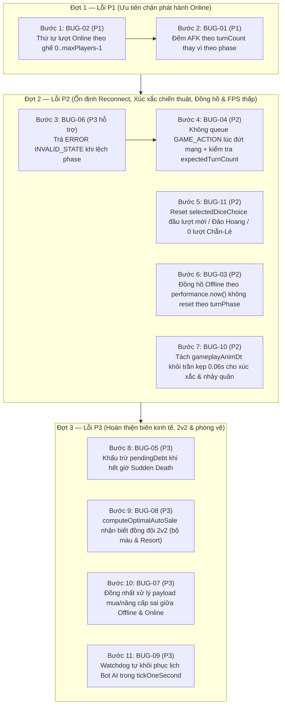

# FIX IMPLEMENTATION PLAN — Kế Hoạch Khắc Phục Lỗi An Toàn (**COMPLETED — 11/11 RESOLVED**)

> **Trạng thái thực thi (2026-11-24):** Toàn bộ 3 Wave (11/11 lỗi + `Audit Hardening` + 7 điểm gia cố Independent Review Round 2) đã được triển khai hoàn tất theo thứ tự phê duyệt và xác minh đầy đủ sau lần sửa cuối (`npm run lint`, `106/106 npm test`, `npm run build`, `45/45 npx playwright test --headed`, `190/190` seeded simulations). Mã nguồn hiện đang ở working tree chưa commit chờ nghiệm thu. Xem chi tiết tại [`BUG-FIX-REPORT.md`](./BUG-FIX-REPORT.md) và [`FINAL-GAMEPLAY-AUDIT.md`](./FINAL-GAMEPLAY-AUDIT.md).

---

## 1. Nguyên tắc bất khả xâm phạm khi sửa lỗi

1. **Giữ nguyên 100% các luật đã được dự án chủ động tùy chỉnh (`CUSTOM`):** Không bật lại xây nhà từ xa ở Start, không mở nâng cấp ngay trong cùng lượt Mua đứt 2×, giữ nguyên `BOARD_SIDES` (`SIDE_MONOPOLY`) gồm cả Resort, giữ nguyên Cúp Quốc Gia 1 host lũy tiến miễn phí, giữ nguyên hoàn 100% vốn khi bán trả nợ và payout phá sản.
2. **Bảo toàn hệ thống Demand-Driven Rendering & tối ưu GPU hiện có:** Khi xử lý `BUG-10`, vẫn giữ nguyên chế độ dừng vẽ WebGL khi bàn cờ tĩnh / tab ẩn và không tăng số lệnh draw call.
3. **Quy trình TDD bắt buộc cho từng bước:** Viết regression test tái hiện lỗi trước → xác nhận test ĐỎ → áp dụng bản vá tối giản đúng root cause → xác nhận test XANH → chạy trọn bộ `npm run lint && npm test && npm run build && npx playwright test --headed`.

---

## 2. Sơ đồ thứ tự ưu tiên & phụ thuộc giữa các bản vá *(Kế hoạch sơ bộ trước điều chỉnh)*

> *Lưu ý:* Sơ đồ ở Mục 2 và bảng kế hoạch ở Mục 3 giữ nguyên bản đề xuất ban đầu trước khi triển khai để đối chiếu; toàn bộ điều chỉnh về mức độ ưu tiên (`BUG-04` P2→P1, `BUG-05` P3→P1), thứ tự Wave thực thi và các điểm gia cố Round 1 & Round 2 được ghi đầy đủ tại **Mục 5** bên dưới và trong [`BUG-FIX-REPORT.md`](./BUG-FIX-REPORT.md).

---

## 3. Chi tiết kỹ thuật từng bước triển khai

| Bước | Mã lỗi | Mức độ | File & Dòng cần sửa | Giải pháp kỹ thuật cụ thể | Regression Test bắt buộc | Độ phức tạp |
|---|---|---|---|---|---|---|
| **1** | `BUG-02` | **P1** | `src/server/roomManager.ts:1090-1145` (`startMatch`) | Duyệt tuần tự `for (let seatIdx = 0; seatIdx < room.maxPlayers; seatIdx++)`: nếu tồn tại `human` có `h.seatIndex === seatIdx` thì tạo `PlayerState` cho human với `id = players.length`, `h.playerId = id`, `teamId = seatIdx % 2`; ngược lại nếu `room.fillBots` bật thì tạo `PlayerState` cho Bot ngay tại vị trí đó với `id = players.length`, `teamId = seatIdx % 2`. | `src/server/roomManager.test.ts`: Phòng `TEAMS_2V2` người thật ghế `0` & `2` → assert `players.map(p => p.teamId)` là `[0, 1, 0, 1]` và `players.map(p => p.isBot)` là `[false, true, false, true]`. | Nhỏ (`S`) |
| **2** | `BUG-01` | **P1** | `src/server/roomManager.ts:185-205, 1170-1195, 3296-3312` | Thêm `lastMissedTurnCountByPlayer: Record<number, number>` vào `MatchRecord`. Trong `tickOneSecond`, khi `!active.isBot` hết giờ phase: chỉ tăng `missedTurnsByPlayer[active.id]` nếu `lastMissedTurnCountByPlayer[active.id] !== match.turnCount`, rồi gán bằng `match.turnCount`. Khi người chơi chủ động gửi action hợp lệ hoặc `RECLAIM_CONTROL`, xóa cả hai bộ đếm của người đó. | `src/server/roomManager.test.ts`: Cho P0 hết giờ cả `AWAIT_ROLL` + `BUY_DECISION` ở Lượt 1 → assert `players[0].isBot === false`, `missedTurnsByPlayer[0] === 1`; sang lượt kế tiếp của P0 hết giờ thêm lần nữa mới `isBot === true`. | Nhỏ (`S`) |
| **3** | `BUG-06` | **P3** | `src/server/roomManager.ts:1223-1225, 1240, 1291-1415` | Tại mọi nhánh guard kiểm tra lệch `match.turnPhase` trong `handleHumanGameAction` / `executeAction`, nếu có `clientId` thì gọi `this.sendError(clientId, 'INVALID_STATE', 'Trạng thái lượt vừa thay đổi, vui lòng thử lại.')` trước khi `return` để client mở khóa `submitOnlineDecision` ngay lập tức. | `src/server/roomManager.test.ts`: Gửi `ROLL_DICE` khi đang `ROLLING_DICE` và `BUY_PROPERTY` khi đang `AWAIT_ROLL` → assert client nhận thông điệp `ERROR` (`code: 'INVALID_STATE'`). | Nhỏ (`S`) |
| **4** | `BUG-04` | **P2** | `src/utils/onlineClient.ts:147-161, 265-276`, `src/game/onlineTypes.ts:74-139`, `src/server/roomManager.ts:1202-1235`, `src/components/ActionDock.tsx:608` | 1. Trong `onlineClient.sendMessage`: chỉ cho xếp hàng `CREATE_ROOM`, `JOIN_ROOM`, `RECONNECT_ROOM` vào `pendingQueueRef`; nếu `msg.type === 'GAME_ACTION'` hoặc `'SEND_EMOTE'` khi `ws.readyState !== WebSocket.OPEN` thì hủy ngay (không push vào queue), gọi `openSocket(true)` và báo trạng thái đang kết nối lại. 2. Bổ sung `expectedTurnCount?: number` và `expectedPhase?: TurnPhase` vào gói `GAME_ACTION`; server từ chối với `ERROR: STALE_ACTION` nếu không khớp `match.turnCount` / `match.turnPhase`. 3. Khóa nút hành động Online trên UI khi `online.connectionStatus !== 'connected'`. | Cập nhật `src/utils/onlineClient.test.ts` (`GAME_ACTION` lúc mất mạng không bị phát lại sau `onopen`) + thêm test `STALE_ACTION` trong `src/server/roomManager.test.ts` + E2E tái chạy kịch bản `F4`. | Vừa (`M`) |
| **5** | `BUG-11` | **P2** | `src/App.tsx:2122-2141`, `src/App.tsx:3920-3940`, `src/components/ActionDock.tsx:511-522` | 1. Thêm `useEffect` trong `src/App.tsx` reset `selectedDiceChoiceRef.current = 'NORMAL'` và `setSelectedDiceChoice('NORMAL')` mỗi khi `viewTurnCount`, `viewActivePlayerIndex` đổi hoặc khi `viewCurrentPlayer?.inJail === true` hoặc `(viewCurrentPlayer?.evenOddCharges ?? 0) <= 0`. 2. Trong `handleRollDice`, ép `effectiveChoice = 'NORMAL'` nếu `!viewTacticalDiceEnabled || viewCurrentPlayer?.inJail || (viewCurrentPlayer?.evenOddCharges ?? 0) <= 0`. | E2E test (hoặc integration test): Bật Xúc xắc chiến thuật Online, bấm `Chẵn`, hết giờ rơi vào Đảo Hoang, tới lượt sau bấm `🎲 Đổ Săn Đôi` 1 lần → assert gửi `diceChoice: 'NORMAL'` và không phát sinh `ERROR: INVALID_ACTION`. | Rất nhỏ (`XS`) |
| **6** | `BUG-03` | **P2** | `src/App.tsx:3850-3865` & `src/App.tsx:3944-3961` | Bỏ `turnPhase` khỏi dependency array của cả hai `useEffect` đồng hồ Offline. Dùng một `setInterval(..., 250)` cố định khi `screenState === 'playing' && !isOnlineMatch`, đo `deltaMs = performance.now() - lastTickMs` và cộng dồn vào bộ tích lũy mili-giây (`matchCarryMsRef`, `turnCarryMsRef`, tạm ngưng cộng `turnCarryMsRef` khi `turnPhaseRef.current` là `ROLLING_DICE` / `MOVING_TOKEN` / `GAME_OVER`). Mỗi khi tích lũy `>= 1000ms` thì trừ `1` giây. | Playwright test / unit timer test: Chơi 30s chuyển phase liên tục → đồng hồ giảm `30 ± 1` giây; bấm Pause 4s → đồng hồ giảm `0` giây. | Nhỏ (`S`) |
| **7** | `BUG-10` | **P2** | `src/components/MonopolyCanvas.tsx:2066, 2110-2114, 2463-2467` & `src/game/graphicsQuality.ts:391-406` | Tách `const gameplayAnimDt = pausedNow ? 0 : Math.min(rawDt, 2.0)` dùng riêng cho `diceAnim.elapsed += gameplayAnimDt` (`:2066`) và `let remainingHopDt = gameplayAnimDt` / `hopAnim.stepElapsed += consume` (`:2110-2114`), trong khi giữ nguyên `const visualAnimDt = pausedNow ? 0 : docHidden ? Math.min(rawDt, 2.0) : Math.min(rawDt, isSoftwareGl ? 0.35 : 0.06)` cho nội suy camera/vật thể trang trí. Đồng thời trong `createBoardFrameScheduler`, nếu `hasPendingGameplayPromises` đang bật mà `rawDtSec > 0.25` (RAF bị OS kẹp 1–2 Hz khi che khuất cửa sổ), tự lên lịch bằng `scheduleTimeout(tick, 80)` cho tới khi giải phóng xong Promise. | Unit test trong `src/game/graphicsQuality.test.ts` + tái chạy kịch bản `F5` (`2.5–5.0 FPS`) và `D4` (cửa sổ thu nhỏ): assert `animateDiceRoll` + `animateTokenPath` luôn kết thúc đúng hạn `< 4.5s` thời gian thực. | Nhỏ (`S`) |
| **8** | `BUG-05` | **P3** | `src/game/rules.ts:1240-1312`, `src/server/roomManager.ts:3216-3238`, `src/App.tsx:3867-3903` | Mở rộng `evaluateTimeLimitWinner(players, properties, matchMode, pendingDebts?)`: với mỗi khoản nợ đang treo `{ debtorId, amount, creditorId }`, khấu trừ `Math.min(netWorth[debtor], amount)` khỏi Net Worth của con nợ (và nếu `creditorId !== null` thì cộng khoản thu thực tế đó cho chủ nợ) trước khi xếp hạng. | `src/game/rules.test.ts`: Con nợ đang treo nợ `1.0M` khi hết giờ bị trừ đúng `1.0M` khi xét ngôi vô địch Sudden Death. | Nhỏ (`S`) |
| **9** | `BUG-08` | **P3** | `src/game/rules.ts:853-906`, `src/server/roomManager.ts:3140, 3354`, `src/App.tsx:3795, 4015`, `src/components/TileModalAndDialogs.tsx:911` | Thêm `players?: PlayerState[], matchMode: MatchMode = 'FFA'` vào `computeOptimalAutoSale`; dùng `const teamIds = getTeamOwnerIds(playerId, players, matchMode)` để đếm tổng Resort cả đội trên `RESORT_TILE_INDICES` tại dòng `881-883` (giống `calculateRent` tại `rules.ts:503-511`) và truyền `players, matchMode` vào `ownsFullColorGroup(playerId, tile.group, properties, players, matchMode)` tại dòng `890`. | `src/game/rules.test.ts`: Ở `TEAMS_2V2`, `computeOptimalAutoSale` giữ lại ô hoàn thành bộ độc quyền màu hoặc Resort chung với đồng đội và bán ô lẻ trước. | Rất nhỏ (`XS`) |
| **10** | `BUG-07` | **P3** | `src/App.tsx:2523-2533, 2627-2638, 2830-2849` | Bỏ lời gọi `completeTurnAfterAction(player)` trong các nhánh chặn payload lỗi / thiếu tiền của `handleBuyProperty`, `handleOnTileUpgrade`, `handleConfirmChampionship` để giữ nguyên modal quyết định giống hệt engine Online. | Kiểm tra unit/E2E: thao tác không hợp lệ không làm mất lượt. | Rất nhỏ (`XS`) |
| **11** | `BUG-09` | **P3** | `src/server/roomManager.ts:3369` | Thêm nhánh `else if (active.isBot && !room.botActionTimer) { match.turnTimeLeft = 15; this.scheduleBotTurnIfNeeded(room); }` cuối `tickOneSecond`. | `src/server/roomManager.test.ts`: Xóa thủ công `botActionTimer` ở lượt Bot, tick về `0` → Bot tự khôi phục lượt. | Rất nhỏ (`XS`) |

---

## 4. Đề xuất bổ sung vào bộ Test Tự Động của Dự Án sau khi sửa lỗi (**COMPLETED**)

1. Đưa bộ simulation có seed vào [`src/server/simulation.test.ts`](../../src/server/simulation.test.ts) (10 trận đại diện cả 5 cấu hình FFA/2v2/Tactical/Festival chạy tự động trong `npm test`) và toàn bộ 190 trận seed gốc vào [`scripts/gameplay-audit/sim.ts`](../../scripts/gameplay-audit/sim.ts).
2. Bổ sung [`e2e/online-resilience.spec.ts`](../../e2e/online-resilience.spec.ts) (chạy `--headed`) kiểm tra không phát lại `GAME_ACTION` cũ khi reconnect (`BUG-04`), trả `INVALID_STATE` (`BUG-06`), thứ tự ghế 2v2 không liên tục (`BUG-02`), reset Xúc xắc chiến thuật (`BUG-11`), đồng hồ Offline (`BUG-03`) và 5 FPS animation (`BUG-10`).

---

## 5. Nhật Ký Điều Chỉnh Kỹ Thuật So Với Bản Kế Hoạch Ban Đầu

Các điểm sau đã được nâng cấp so với phương án sơ bộ ban đầu nhằm giải quyết triệt để edge case thực tế mà không thay đổi luật chơi:

1. **Điều chỉnh thứ tự triển khai & Severity:** Nâng `BUG-04` (P2 → P1) và `BUG-05` (P3 → P1), đưa cả hai vào **Wave 1** (`BUG-02 → BUG-01 → BUG-06 → BUG-04 → BUG-05`), Wave 2 (`BUG-11 → BUG-03 → BUG-10`), Wave 3 (`BUG-08 → BUG-07 → BUG-09`).
2. **`BUG-04` (bổ sung `decisionRevision`, `actionId` theo người chơi, `isSynced` & guard socket cũ):** Do cùng một `turnPhase` (`AWAIT_ROLL`, `REROLL_DECISION`) có thể lặp lại trong cùng `turnCount` khi đổ Đôi hoặc nộp phạt Đảo Hoang, chỉ kiểm tra `expectedTurnCount + expectedPhase` chưa đủ — đã bổ sung `decisionRevision` tăng đơn điệu theo quyết định, hàng đợi khử trùng `processedActionIds` (256 phần tử) khóa theo từng người chơi `${playerId}:${actionId}`, cờ `isSynced` chặn mở khóa UI trước khi nhận snapshot đồng bộ mới sau reconnect, và guard `wsRef.current !== ws` chống socket cũ đóng trễ.
3. **`BUG-05` (định giá `effectiveNetWorthByPlayerId` + `effectiveCashByPlayerId` không đột biến sở hữu):** Thay vì ép thanh lý hay tạo luật phá sản mới lúc hết giờ `20:00`, hàm `computeEffectiveNetWorths` xử lý tuần tự FIFO toàn bộ `[pendingDebt, ...pendingDebtQueue]` (khử trùng lặp theo tham chiếu, định giá 100% vốn BĐS theo Spec §3.6, chặn tối đa theo tài sản còn lại của con nợ) và truyền đồng nhất `effectiveNetWorthByPlayerId` lẫn `effectiveCashByPlayerId` (kèm tie-break `laps`) cho Offline, Online, `rankPlayersForVictory` và `VictoryModal`.
4. **`BUG-03` (module đồng hồ đơn điệu tách biệt):** Đóng gói thành [`src/game/gameplayClock.ts`](../../src/game/gameplayClock.ts) có unit test độc lập (`gameplayClock.test.ts`), tách riêng `matchClockRef` và `turnClockRef` chạy bằng `performance.now()` trên nhịp 200ms + `visibilitychange`, nâng cấp `ensureFloor(minSeconds, nowMs, wasActive)`, flush `turnClock` khi `commitTurnPhase` rời pha active và đồng bộ timestamp khi đóng/mở `RulebookModal`.
5. **`BUG-10` (Single-flight `scheduleToken` RAF Watchdog `500ms` & Low-FPS Pause/Resume):** Thay vì chỉ dùng heuristic `rawDtSec > 0.25` (và tránh bẫy fallback `120ms` cắt ngang RAF `5/2.5 FPS`), `createBoardFrameScheduler` dùng `scheduleToken` đơn điệu + timer dự phòng `500ms` loại trừ lẫn nhau với RAF (chỉ bật khi `hasPendingGameplayPromises()` là `true`) để `60/30/15/5/2.5 FPS` chạy 100% thuần RAF, `0` tick trùng lặp, `0` timer thừa lúc idle, đồng bộ `lastTimeMs` trong `handleVisibilityChange` từ idle sang `background_sim`, thêm latch `justResumedFromPauseRef` trong `MonopolyCanvas.tsx` và giữ nguyên Demand-Driven Rendering + iGPU Low/Medium/High.
6. **`BUG-09` (State-Aware Bot Watchdog):** Không chỉ thêm nhánh `else if (!room.botActionTimer)`, đã bổ sung `inFlightBeatCount` (đo trên `waitRoomBeat`), `botActionExecuting`, `botScheduledMeta` và giới hạn cứng `botWatchdogAttempts <= 2` để phân biệt chính xác Bot đang chờ lịch / đang thực thi / đang chờ async beat / bị rơi timer và tuyệt đối không tạo 2 hành động Bot song song hay vòng lặp vô hạn.
7. **Audit Hardening (Round 1) & Independent Review (Round 2):** Chuyển 6 hàm `perform*` (`Buy`, `Upgrade`, `ConfirmBuyout`, `Championship`, `TacticalCard`, `SellAndPayDebt`) trả về `boolean` + `INVALID_ACTION` (và đồng bộ Offline `handleConfirmBuyout` chỉ auto-end cho Bot) + xác thực đồng bộ `SELECT_WORLD_TOUR` để thao tác bị từ chối không reset `missedTurnsByPlayer` hay ghi `processedActionIds`; trong `BUG-01`, `RECONNECT_ROOM` bảo toàn `lastHumanActionTurnCountByPlayer`, `RECLAIM_CONTROL` ghi nhận tương tác lượt hiện tại, và cả hai nhánh cấp sàn `ensureSubPhaseTimeFloor(match, 18)` khi khôi phục quyền người thật từ Bot takeover ở pha quyết định.
