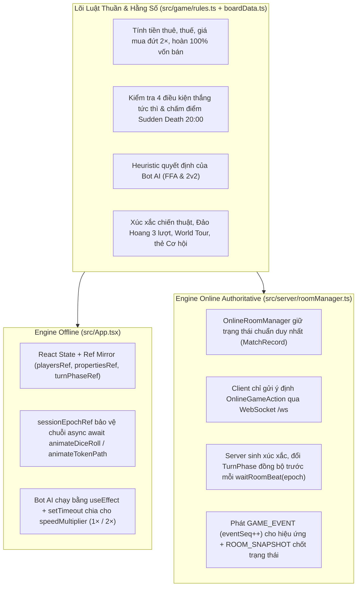
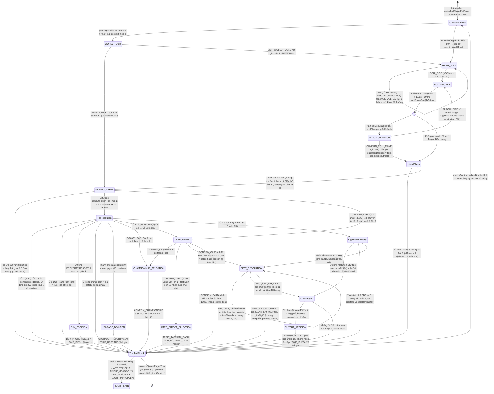

# Gameplay Flow & Game State Machine (Phục Dựng Từ Implementation Thực Tế)

> **Cập nhật hậu khắc phục & Independent Review (2026-11-24):** Toàn bộ 11/11 lỗi kiến trúc, đồng bộ, đồng hồ, animation và Bot watchdog được ghi nhận ở mốc baseline `515feab` (`BUG-01` → `BUG-11`) cùng 7 điểm gia cố Round 2 đã được **khắc phục & xác minh (`FIXED & VERIFIED`)** (bổ sung `src/game/gameplayClock.ts`, `decisionRevision` + `actionId` + `isSynced`, `computeBoardFrameDeltas` + `500ms` single-flight RAF fallback, và state-aware Bot watchdog). Xem chi tiết tại [`BUG-FIX-REPORT.md`](./BUG-FIX-REPORT.md) · [`PERFORMANCE-COMPARISON.md`](./PERFORMANCE-COMPARISON.md) · [`FINAL-GAMEPLAY-AUDIT.md`](./FINAL-GAMEPLAY-AUDIT.md).
> *(Các mô tả baseline `515feab` bên dưới được bảo toàn kèm trạng thái hậu sửa lỗi để đối chiếu Before/After minh bạch).*

- **Nguồn đối chiếu trực tiếp** *(số dòng ghi theo mốc baseline `515feab`; hậu sửa lỗi bổ sung thêm `src/game/gameplayClock.ts`)*:
  - Luật thuần dùng chung: `src/game/rules.ts` (`2.568` dòng), `src/game/boardData.ts` (`531` dòng), `src/game/types.ts` (`209` dòng), `src/game/onlineTypes.ts` (`214` dòng)
  - Engine Offline (Client-driven): `src/App.tsx` (`4.945` dòng)
  - Engine Online (Server-authoritative): `src/server/roomManager.ts` (`3.372` dòng), `src/server/wsServer.ts` (`200` dòng), `src/utils/onlineClient.ts` (`455` dòng)
  - Hệ thống 3D, Vật lý, Kho bạc & Âm thanh: `src/components/MonopolyCanvas.tsx` (`2.694` dòng), `src/three/physicsEngine.ts` (`429` dòng), `src/three/treasurySystem.ts` (`1.108` dòng), `src/audio/soundEngine.ts` (`497` dòng)

---

## 1. Kiến trúc tổng thể: Hai Engine song song dùng chung lõi Luật Thuần

---

## 2. Vòng đời màn hình trận đấu (`GameScreenState`)

Lưu ý thực tế trong code (`src/App.tsx:635-643`): cả sảnh Offline lẫn sảnh phòng chờ Online (`roomSnapshot.status === 'lobby'`) đều ánh xạ vào `viewScreenState === 'title'` (render thông qua `StartModal` + `OnlineLobbyPanel`).

```mermaid
stateDiagram-v2
    [*] --> title: Mở ứng dụng (StartModal)
    title --> title: Chuyển tab Offline ↔ Online / Tạo & Join phòng (?room=CODE)
    title --> playing: Offline startNewGame() / Online Host gửi START_MATCH
    playing --> paused: Nhấn Esc hoặc nút Tạm dừng (Offline: đóng băng đồng hồ & 3D; Online: chỉ mở overlay cục bộ, trận đấu vẫn chạy)
    paused --> playing: Tiếp tục
    paused --> title: Thoát ra sảnh chính / LEAVE_ROOM
    playing --> gameover: Thỏa mãn evaluateMatchWinner() hoặc hết 20:00 (evaluateTimeLimitWinner)
    gameover --> title: Offline Chơi ván mới / Online Host gửi RETURN_TO_LOBBY (đưa cả 4 client về sảnh phòng)
```

---

## 3. State Machine chi tiết của một lượt chơi (`TurnPhase` — 12 pha trong lượt + `GAME_OVER`)

Tập giá trị `TurnPhase` (13 union literals) trong `src/game/types.ts:127-140`:
`WORLD_TOUR` · `AWAIT_ROLL` · `ROLLING_DICE` · `REROLL_DECISION` · `MOVING_TOKEN` · `BUY_DECISION` · `UPGRADE_DECISION` · `BUYOUT_DECISION` · `CHAMPIONSHIP_SELECTION` · `CARD_REVEAL` · `CARD_TARGET_SELECTION` · `DEBT_RESOLUTION` · `GAME_OVER`.

### Trường hợp đặc biệt đã xác minh trong code: Chuỗi nợ đa người chơi của thẻ Sinh Nhật (`ch-10`)
- Khi người chơi $P_a$ rút thẻ `ch-10` (`COLLECT_FROM_ALL` `25K`), mọi đối thủ đủ tiền bị trừ `25K` ngay; những đối thủ thiếu tiền nhưng còn BĐS được đưa vào `pendingDebtQueue` (`roomManager.ts:2348-2425`, `App.tsx:3060-3148` & `1388-1463`).
- Engine lưu `debtReturnToPlayerIndex = P_a` (bảo toàn cả `doublesStreak` của $P_a$), tạm thời chuyển `activePlayerIndex` lần lượt sang từng con nợ để họ tự chọn bán BĐS trả nợ (`SELL_AND_PAY_DEBT`) hoặc tuyên bố phá sản (`DECLARE_BANKRUPTCY`).
- Sau khi con nợ cuối cùng trong hàng đợi giải quyết xong (nếu trận đấu chưa kết thúc vì `LAST_STANDING`), quyền điều khiển được trả về đúng cho $P_a$ để kết thúc lượt hoặc hưởng quyền đổ tiếp Đôi! (Đã có unit test & E2E `BUG-14` kiểm chứng ≥ 2 con nợ liên tiếp).

---

## 4. So sánh chi tiết kiến trúc & hành vi Offline vs Online

| Khía cạnh | Chế độ Offline (`src/App.tsx`) | Chế độ Online (`src/server/roomManager.ts` + `onlineClient.ts`) | Đánh giá đồng nhất |
|---|---|---|---|
| **Nguồn sự thật (Authority)** | Client cục bộ (`playersRef`, `propertiesRef`, `turnPhaseRef`) | **100% Server-authoritative** (`MatchRecord` trên Node.js). Client không thể tự cộng tiền, tự chọn ô hay giả mạo kết quả xúc xắc. | Tốt — chống gian lận chặt chẽ ở Online. |
| **Chống bấm đúp, Stale Action & Reconnect** | Kiểm tra đồng bộ `turnPhaseRef.current` ngay dòng đầu tiên của mọi handler (`handleRollDice`, `handleBuyProperty`...) | Server đổi `match.turnPhase` đồng bộ trong cùng tick trước mọi `await`; client có khóa `submitOnlineDecision` (6s). *(Baseline `515feab`: từng queue `GAME_ACTION` lúc mất mạng — `BUG-04` và bỏ qua im lặng sai phase — `BUG-06`.)* **Hậu sửa lỗi (`BUG-04` & `BUG-06` FIXED):** Bổ sung `decisionRevision` đơn điệu, kiểm tra `expectedTurnCount`/`expectedPhase`/`expectedDecisionRevision` (`STALE_ACTION`), khử trùng `actionId` theo từng người chơi `${playerId}:${actionId}` (`DUPLICATE_ACTION`), phản hồi ngay `ERROR: INVALID_STATE` mở khóa nút tức thì, giới hạn `pendingQueueRef` chỉ cho 3 lệnh bootstrap phòng, cờ `isSynced` chặn thao tác trước khi nhận snapshot tươi và guard `wsRef.current !== ws` chống socket cũ đóng trễ. | **Đã gia cố & xác minh (`BUG-04` & `BUG-06` FIXED & VERIFIED)** |
| **Tốc độ trận đấu (`1×` / `2×`)** | Cho phép chuyển đổi `1× ↔ 2×` tức thời ngay giữa animation | Khóa cứng ở `1×` (`1× (Khóa Online)` trong `ActionDock.tsx:382`) để đồng bộ nhịp chờ giữa mọi người chơi. | Khác biệt có chủ đích và hợp lý. |
| **Tạm dừng (`PauseModal` / `Esc`)** | Đóng băng đồng hồ trận, đồng hồ lượt và vòng lặp `MonopolyCanvas` (`isPaused = true`) | Chỉ mở menu cá nhân cục bộ; đồng hồ server và `MonopolyCanvas` (`isPaused = false`, `App.tsx:4538-4539`) vẫn chạy bình thường. | Khác biệt có chủ đích (game nhiều người không dừng server). |
| **Đồng hồ trận `20:00` & lượt `45s`** | *(Baseline `515feab`: `setInterval(1000)` phụ thuộc `turnPhase` → trôi chậm ~28.3% — `BUG-03`.)* **Hậu sửa lỗi (`BUG-03` FIXED):** Chuyển sang `src/game/gameplayClock.ts` tách riêng `matchClockRef` & `turnClockRef` đơn điệu theo `performance.now()` tích lũy `carryMs` (`ensureFloor(..., wasActive)` + đồng bộ Pause/`RulebookModal`, trôi `0.0s / 61.0s`). | Một `setInterval(1000)` duy nhất trên server + đẩy `matchTimeLeft` qua mỗi `ROOM_SNAPSHOT` → chính xác theo giây thực. | **Đã đồng nhất (`BUG-03` FIXED & VERIFIED)** |
| **Hết giờ lượt & Bot Watchdog** | Tự động đổ / bỏ qua / bán tối ưu trả nợ; không chuyển ghế thành Bot AI | Tự động hành động kèm tăng `missedTurnsByPlayer`; đủ 2 lượt trọn vẹn liên tiếp thì Bot AI tiếp quản tạm thời (cho phép bấm `Lấy Lại Quyền Điều Khiển`). *(Baseline `515feab`: đếm AFK theo sub-phase — `BUG-01` & thiếu watchdog Bot — `BUG-09`.)* **Hậu sửa lỗi (`BUG-01` & `BUG-09` FIXED):** Giới hạn đếm AFK tối đa 1 lần mỗi `turnCount` (loại trừ nợ ngoại lượt `ch-10`, giữ ghi nhận tương tác một phần qua `RECONNECT_ROOM`, ghi nhận & cấp sàn `18s` khi `RECLAIM_CONTROL`/khôi phục quyền từ Bot) và bổ sung state-aware Bot watchdog (`inFlightBeatCount`, `botActionExecuting`, `botScheduledMeta`, tối đa `2` lần phục hồi). | **Đã chuẩn hóa (`BUG-01` & `BUG-09` FIXED & VERIFIED)** |
| **Thứ tự ghế khi bắt đầu ván** | Giữ nguyên thứ tự slot `0 → 1 → 2 → 3` | *(Baseline `515feab`: đẩy Human lên trước, Bot xuống sau — `BUG-02`.)* **Hậu sửa lỗi (`BUG-02` FIXED):** `startMatch` duyệt 1 vòng lặp duy nhất theo `seatIdx = 0..maxPlayers-1`, bảo toàn thứ tự ghế thực, luân phiên đội 2v2 `[0, 1, 0, 1]` và khớp HUD / khay tiền 3D / `yourPlayerId`. | **Đã đồng nhất (`BUG-02` FIXED & VERIFIED)** |
| **Reset lựa chọn Xúc xắc Chẵn/Lẻ (`selectedDiceChoice`)** | `enterRollPhaseForPlayer` luôn reset về `'NORMAL'` đầu mỗi pha đổ; đồng thời chuẩn hóa phòng vệ qua `normalizeTacticalDiceChoice`. | *(Baseline `515feab`: client Online không reset khi đổi lượt / vào Đảo Hoang — `BUG-11`.)* **Hậu sửa lỗi (`BUG-11` FIXED):** Bổ sung `useEffect` reset về `'NORMAL'` theo lượt/pha/`inJail`/`evenOddCharges <= 0` + chuẩn hóa trong `handleRollDice` và bảo vệ `aria-pressed` trên `ActionDock`. | **Đã đồng nhất (`BUG-11` FIXED & VERIFIED)** |
| **Payload quyết định không hợp lệ** | *(Baseline `515feab`: tự gọi `completeTurnAfterAction` — `BUG-07`.)* **Hậu sửa lỗi (`BUG-07` FIXED):** Dùng chung `validateInitialPropertyPurchase`, `validateChampionshipHostSelection`, `canBuyoutProperty`; giữ nguyên modal & `isFreeChampionship` cho người chơi (chỉ fallback kết thúc lượt cho Bot). | Trả `ERROR: INVALID_ACTION` (trả `false`, không reset AFK và không ghi `processedActionIds`) và giữ nguyên phase quyết định cho cả Mua, Nâng cấp, Đăng cai Cúp, Thẻ chiến thuật, Trả nợ và Mua đứt (`performConfirmBuyout`). | **Đã đồng nhất (`BUG-07` FIXED & VERIFIED)** |
| **Sudden Death (`TIME_LIMIT`) khi còn `pendingDebt` / `pendingDebtQueue`** | *(Baseline `515feab`: bỏ qua nợ treo — `BUG-05`.)* **Hậu sửa lỗi (`BUG-05` FIXED):** `evaluateTimeLimitWinner` dùng `computeEffectiveNetWorths` khấu trừ FIFO toàn bộ nợ treo (`100%` vốn BĐS theo Spec §3.6, không tạo luật phá sản mới) và truyền `effectiveNetWorthByPlayerId` + `effectiveCashByPlayerId` cho `rankPlayersForVictory` / `VictoryModal`. | Dùng chung `evaluateTimeLimitWinner` & `computeEffectiveNetWorths`, đồng thời xóa sạch trạng thái treo (`pendingDebt`, `pendingDebtQueue`, `drawnCard`, ...) khi chuyển `GAME_OVER`. | **Đã đồng nhất (`BUG-05` FIXED & VERIFIED)** |
| **Bán tài sản trả nợ tối ưu (`computeOptimalAutoSale`) ở `TEAMS_2V2`** | *(Baseline `515feab`: bỏ qua tài sản đồng đội 2v2 — `BUG-08`.)* **Hậu sửa lỗi (`BUG-08` FIXED):** Truyền `players, matchMode` vào `computeOptimalAutoSale` (UI gợi ý & auto-sale hết giờ/Bot) để bảo vệ bộ màu độc quyền và cụm Resort chung của đội. | Dùng chung `computeOptimalAutoSale(..., players, matchMode)` cho cả auto-sale hết giờ và Bot AI 2v2 (`sim.ts` lô `B4` giảm `DEBT_RESOLUTION` `70 → 60`). | **Đã đồng nhất (`BUG-08` FIXED & VERIFIED)** |
| **Bình luận Bot AI (Gemini Quips)** | Client gọi `POST /api/bot-quip`; nếu thiếu key hoặc lỗi mạng/500 thì tự sinh câu thoại tiếng Việt offline (`botQuipClient.ts:21-53`) | Server gọi trực tiếp hàm tạo thoại (hoặc `generateOfflineBotQuip` khi không có `GEMINI_API_KEY`) và phát cho mọi người trong phòng. | Hoạt động mượt mà, không ảnh hưởng luồng gameplay kể cả khi API lỗi (`F7`). |

---

## 5. Đồng bộ Animation Vật lý, Kho bạc 3D & Demand-Driven Rendering

1. **Xúc xắc vật lý tất định (`src/three/physicsEngine.ts`):**
   - Dùng `cannon-es` mô phỏng trước tối đa `165` bước (`dt = 1 / 90`, `90 Hz`, `src/three/physicsEngine.ts:231-232`) trong sân giữa bàn cờ cho tới khi 2 viên xúc xắc đứng yên, sau đó nhân hậu nghiệm quaternion hoán vị nhóm bát diện `qRemap` để mặt ngửa lên trời (`+Y`) **luôn khớp chính xác 100%** với cặp `(die1, die2)` do game logic quyết định.
   - Thời lượng thực tế đo trên cả 36 tổ hợp `(1..6 × 1..6)` là `1.30s – 1.38s`, nhỏ hơn khoảng chờ `1.45s` (`waitRoomBeat`) của server Online nên không bị chồng chéo sang pha nhảy quân cờ.
2. **Landing Latch chống giật quân cờ Online (`src/components/MonopolyCanvas.tsx`):**
   - Sau khi `TOKEN_MOVED` nhảy tới ô đích ở client trước khi gói `ROOM_SNAPSHOT` kế tiếp kịp tới, cơ chế *landing latch* giữ quân cờ đứng yên tại ô đích thay vì giật ngược về ô cũ trong vài chục mili-giây chờ mạng.
3. **Kho bạc 3D & Bay tiền (`src/three/treasurySystem.ts`):**
   - Hoàn toàn tách rời khỏi logic số dư: hệ thống chỉ đọc chênh lệch giữa hai snapshot tiền mặt (`detectCashSnapshotChanges` & `detectCashFlowTransfers`) để diễn hoạt cọc tiền giấy / xu / vàng thỏi bay giữa khay người chơi và Ngân hàng trung tâm. Tuyệt đối không cộng/trừ tiền từ phía animation.
4. **Demand-Driven Rendering & Background Simulation (`src/game/graphicsQuality.ts`):**
   - Khi bàn cờ đứng yên hoặc ở mức đồ họa Thấp/Vừa, bộ lập lịch `createBoardFrameScheduler` hạ nhịp vẽ hoặc dừng hẳn `requestAnimationFrame` để tiết kiệm GPU.
   - Khi `document.hidden === true` và đang có Promise xúc xắc/quân cờ chờ giải phóng, bộ lập lịch chuyển sang `mode: 'background_sim'` (timer `80ms` không gọi lệnh vẽ WebGL, cho `animDt` tiến tới `2.0s`).
   - **Điểm nghẽn ở baseline (`BUG-10` — ĐÃ KHẮC PHỤC & XÁC MINH):** Ở baseline `515feab`, khi `document.hidden === false` nhưng FPS thực tế dưới `16.7 FPS` (máy yếu hoặc cửa sổ bị che khuất khiến OS hạ nhịp RAF xuống `1–2.4 Hz`), trần kẹp chung `Math.min(rawDt, 0.06)` cộng vào `diceAnim.elapsed` và `hopAnim.stepElapsed` làm tiến trình giải phóng Promise bị kéo giãn `3.5×–16.7×`. **Hậu sửa lỗi (`BUG-10` FIXED):** `computeBoardFrameDeltas()` (`src/game/graphicsQuality.ts`) tách sạch `gameplayAnimDt` (bám thời gian thực `<= 10.0s`, bằng `0` khi Pause, kẹp `<= 0.05s` frame đầu sau Resume kèm latch `justResumedFromPauseRef`) khỏi `visualAnimDt` (`<= 0.06s` hardware / `<= 0.35s` software) và `simDt` (`<= 0.08s`); `createBoardFrameScheduler` bổ sung single-flight RAF fallback (`rafFallbackMs = 500ms`, dùng `scheduleToken` đơn điệu loại trừ lẫn nhau, chỉ bật khi `hasPendingGameplayPromises()` là `true` và đồng bộ `lastTimeMs` khi `handleVisibilityChange` từ idle sang `background_sim`), đưa `60/30/15/5/2.5 FPS` về `5.54s–6.10s` trên 100% thuần RAF, bảo toàn thứ tự `onStep`, `resolveOnce()`, cleanup khi Pause/Resume/Reset/Unmount/Reconnect, đúng `1` `WebGLRenderer`, Demand-Driven Rendering (`3` draws/3s lúc idle ở mức `Low`) và 3 mức Graphics Quality Low/Medium/High.

---

## 6. Các bất biến (Invariants) đã được xác minh thực nghiệm

Qua **190 trận Bot-vs-Bot** chạy trên engine kèm bộ kiểm tra bất biến ở mỗi vòng lặp sự kiện và các bài kiểm thử Playwright đa trình duyệt:
- Không người chơi còn sống nào có `cash < 0` hoặc `Number.isNaN(cash)`.
- Mọi người chơi đã `bankrupt === true` đều có `cash === 0` và sở hữu đúng `0` bất động sản.
- Mọi ô vô chủ (`ownerId === null`) đều có `level === 0`, không còn cờ Cúp hay Khiên; mọi ô `RESORT` luôn có `level === 0`; mọi thành phố có `level ∈ {0, 1, 2, 3, 4}`.
- Khi trận đấu đang diễn ra (`status === 'playing'`), `activePlayerIndex` không bao giờ dừng lại ở một người chơi đã phá sản.
- `0/190` trận bị deadlock hoặc chạm trần vòng lặp an toàn; `0` lỗi `ERROR` phát sinh từ quyết định của Bot AI.
